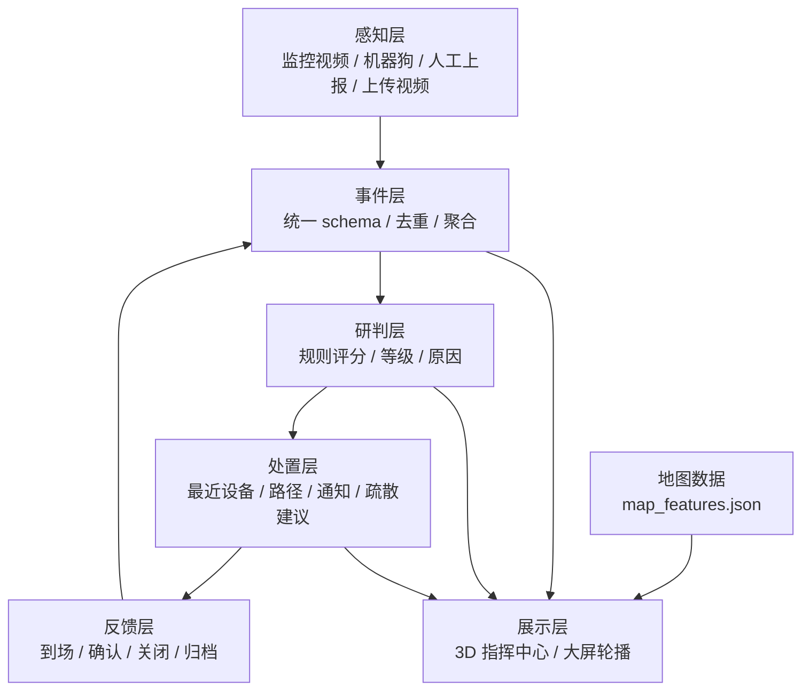

# 智慧巡检联动演示 · 技术方案

版本：v1.0
日期：2026-11-03
适用：下周机器人大会展台版
目标：一周内交付可离线运行、可讲解、可互动的联动处置演示

---

## 一、目标与范围

### 1.1 目标

在现有 `visual_inspection_demo` 基础上，新增一个“联动指挥”演示模块，做到：

1. 低模 3D 校园地图，能看到校园、小区、森林三个片区的空间关系。
2. 人员密度事件从发现到关闭的完整链路。
3. 大屏自动轮播，笔记本可交互讲解。
4. 机器狗作为遥控移动节点参与调度，回传第一视角。
5. 上传视频触发一次完整闭环，作为压轴互动。

### 1.2 不在本期范围

- 真实监控摄像头接入
- 真实安保、消防、广播系统对接
- 机器狗自主导航
- 地铁完整建模
- 多路视频并发推理
- 人脸识别与个人身份识别

### 1.3 原则

- 全离线运行，不依赖外网。
- 演示数据明确标注为模拟。
- 预计算为主，实时推理为辅。
- 数据与渲染解耦，3D 不可用时能切 2.5D。
- 不覆盖现有展示页，保留兜底入口。

---

## 二、假设与边界

| 项目 | 当前假设 | 不成立时的处理 |
| --- | --- | --- |
| 密度模型 | 可稳定输出人数与检测框 | 若只输出人数，按区域计数；若不可用，用预置数据 |
| 机器狗 | 可遥控行走，有摄像头 | 不能走则当静态节点；无图传则播预录第一视角 |
| 大屏 | 有，可接笔记本 | 没有则只用笔记本，轮播窗口化 |
| 人力 | 足够，可并行 | 按角色裁剪，优先保 3D、事件流、上传闭环 |
| 地图 | 已有俯视图，按图描轮廓 | 无比例尺则用像素坐标，不做真实距离 |
| 其他模型 | 组内在做，第 3 天截止 | 未交付进路线图，不进必选路径 |

---

## 三、总体架构



五层职责：

| 层 | 职责 | 关键产物 |
| --- | --- | --- |
| 感知层 | 接收视频、设备、人工上报 | 原始检测结果 |
| 事件层 | 统一格式、去重、按区域聚合 | 事件对象 |
| 研判层 | 规则打分、等级、原因 | 严重性与解释 |
| 处置层 | 选最近设备、算路径、生成通知与建议 | 调度单 |
| 反馈层 | 记录到场、确认、关闭 | 状态流转 |

事件层是核心资产。地图换了，事件层可以保留；场景换了，规则可以复用。

---

## 四、事件模型

### 4.1 事件字段

```json
{
  "event_id": "evt_20261109_0001",
  "scene": "campus",
  "task_id": "density_gate",
  "type": "出入口拥挤",
  "title": "南门出入口人员密度超阈值",
  "location": {
    "zone_id": "central_plaza",
    "zone_name": "中心广场",
    "x": 358.7,
    "y": 463.8
  },
  "confidence": 0.86,
  "severity": {
    "score": 72,
    "level": "高",
    "factors": ["出入口", "持续 3 分钟", "密度上升"]
  },
  "source": {
    "kind": "camera",
    "id": "cam_south_gate",
    "simulated": true
  },
  "timestamp": "2026-11-09T10:12:00+08:00",
  "status": "dispatched",
  "dispatch": {
    "device_id": "dog_01",
    "device_name": "巡检机器狗 01",
    "eta_s": 95,
    "path": [[358, 463], [330, 480], [300, 500]]
  },
  "timeline": [
    {"t": "10:12:00", "state": "detected"},
    {"t": "10:12:03", "state": "scored"},
    {"t": "10:12:08", "state": "dispatched"},
    {"t": "10:13:40", "state": "arrived"},
    {"t": "10:15:10", "state": "resolved"}
  ]
}
```

### 4.2 状态机

```text
detected -> scored -> dispatched -> arrived -> confirmed -> resolved
                                  \-> escalated
```

| 状态 | 含义 | 界面表现 |
| --- | --- | --- |
| detected | 检测到异常 | 地图落点，黄色脉冲 |
| scored | 完成研判 | 风险面板出现，显示原因 |
| dispatched | 已下发调度 | 路径线出现，设备图标移动 |
| arrived | 设备到场 | 视频面板切到现场画面 |
| confirmed | 现场确认 | 事件卡片更新 |
| resolved | 处置完成 | 事件转绿，进入归档 |
| escalated | 升级处置 | 事件转红，通知更高层级 |

### 4.3 去重与聚合

同一区域、同一类型的事件，在 60 秒窗口内合并为一条，更新计数与持续时间，不重复落点。

聚合键：`scene + task_id + zone_id + type`。

---

## 五、研判规则

### 5.1 评分公式

```text
score = clamp(base + location + duration + trend + confidence, 0, 100)
```

| 因子 | 取值 | 分值 |
| --- | --- | --- |
| base | 出入口拥挤 | 60 |
| base | 人员异常聚集 | 50 |
| base | 通道堵塞 | 55 |
| base | 电动车入楼 | 65 |
| base | 烟雾 | 80 |
| base | 明火 | 95 |
| location | 出入口 | +15 |
| location | 消防通道 | +20 |
| location | 地下空间 | +10 |
| location | 宿舍区 | +10 |
| location | 普通区域 | 0 |
| duration | 小于 60 秒 | 0 |
| duration | 60 到 180 秒 | +5 |
| duration | 180 到 300 秒 | +10 |
| duration | 超过 300 秒 | +15 |
| trend | 上升 | +10 |
| trend | 平稳 | +5 |
| trend | 下降 | 0 |
| confidence | 低于 0.6 | -10 |
| confidence | 0.6 到 0.8 | 0 |
| confidence | 高于 0.8 | +5 |

### 5.2 等级

| 分数 | 等级 | 处置建议 |
| ---: | --- | --- |
| 0 到 39 | 低 | 记录，持续观察 |
| 40 到 59 | 中 | 通知巡逻人员 |
| 60 到 79 | 高 | 调度最近设备，通知安保 |
| 80 到 100 | 紧急 | 调度设备，通知安保与值班领导，准备疏散 |

### 5.3 可解释性

界面上必须显示每个因子的贡献，例如：

```text
基础分 60（出入口拥挤）
+15 出入口
+10 持续 3 分钟
+10 密度上升
+5 置信度 0.86
= 72 高
```

技术观众看到“为什么是 72 分”，信任度会明显上升。

### 5.4 密度事件聚合

```text
density_index = count / area_px * 10000
```

- `count`：区域内人数
- `area_px`：区域多边形像素面积
- 阈值默认：预警 0.6，高 1.2，紧急 2.0
- 持续时间默认：演示 5 秒，真实场景可配置到 180 秒
- 趋势：当前人数与 30 秒前比较

阈值必须用现场素材标定，默认值只用于演示，不作为真实标准。

---

## 六、地图数据

### 6.1 来源与坐标

源图：`D:\Desktop\demo\source\maps\campus_overview_960x1218.png`，960 × 1218 像素。

坐标：像素坐标，左上角为原点，x 向右，y 向下。

描图结果：`D:\Desktop\demo\map_trace\out\map_features.json`。

### 6.2 要素清单

| id | 名称 | kind | bbox | height_level |
| --- | --- | --- | --- | ---: |
| north_dorm | 北区学生公寓 | residential | 136,14,342,136 | 3 |
| west_dorm | 西区学生公寓及西侧绿地 | residential | 60,150,168,400 | 3 |
| central_plaza | 中心广场 | plaza | 245,376,227,170 | 0 |
| east_dorm | 东区学生公寓 | residential | 592,327,156,157 | 3 |
| south_green | 南部绿地 | green | 494,797,219,217 | 0 |
| teaching_1 | 1号教学楼 | teaching | 216,221,283,92 | 4 |
| library | 图书馆 | teaching | 286,316,142,76 | 4 |
| hospital | 校医院 | public | 222,118,138,70 | 3 |
| c1 | 中央院系区 C1 | teaching | 258,554,96,304 | 4 |
| c2 | 中央院系区 C2 | teaching | 372,556,106,220 | 4 |
| modern_edu | 现代教育中心 | teaching | 386,821,126,39 | 3 |
| water_south | 南部水体 | water | 330,958,104,188 | 0 |
| track_west | 西田径场 | sports | 151,292,116,178 | 0 |
| track_east | 东田径场 | sports | 452,265,98,180 | 0 |
| gym | 体育馆 | sports | 550,285,75,144 | 2 |
| lab_center | 实验中心区 | lab | 443,475,187,330 | 4 |
| talent_apartment | 人才公寓 | residential | 725,829,192,190 | 5 |
| reserved_sw | 待建区域（西南） | reserved | 155,922,235,183 | 1 |
| reserved_sc | 待建区域（南中） | reserved | 465,991,218,173 | 1 |
| reserved_se | 待建区域（东南） | reserved | 789,1025,131,124 | 1 |

校园外轮廓：60 个点，字段 `campus_boundary`。

### 6.3 高度映射

`height_level` 是 0 到 5 的相对等级，不是真实米数。

建议映射：`world_height = height_level * 3`，即 0 到 15 个世界单位。

| 等级 | 含义 | 示例 |
| ---: | --- | --- |
| 0 | 平面 | 广场、田径场、水体 |
| 1 | 低层 | 待建区域 |
| 2 | 低层公共建筑 | 体育馆 |
| 3 | 多层 | 宿舍、校医院、现代教育中心 |
| 4 | 中高层 | 教学楼、图书馆、实验楼 |
| 5 | 高层 | 人才公寓 |

### 6.4 坐标转换

```text
world_x = (pixel_x - 666.5) × 1.0     // 图幅 1333 像素
world_z = (pixel_y - 539.5) × 1.0     // 图幅 1079 像素
world_y = 高度（米）
```

比例尺 `meters_per_px` 取 1.0，地图即 1.33 × 1.08 公里。世界以地图中心为原点，地面平面按 `WORLD` 尺寸生成，不再另加边距。

### 6.5 后续细分

当前是分区级描图。分区内的单栋建筑，例如 B-1 至 B-10、X-1 至 X-10、C1-1 至 C1-4、C2-1 至 C2-4、D-1 至 D-5，尚未拆分。

下一步用两种方式补齐：

1. 用户提供的描图代码，放入 `tools/legacy_trace/`，输出同一格式。
2. 用已检测的 46 个白色中心点作为种子，结合局部边缘做单栋建筑分割。

---

## 七、3D 场景

### 7.1 技术选型

- Three.js，本地文件，不走 CDN。
- 无构建步骤，原生 ES Module 加 importmap。
- 低多边形，纯色材质，不贴图。
- 正交相机做主视角，透视相机做飞越。

### 7.2 场景组成

| 图层 | 内容 | 说明 |
| --- | --- | --- |
| 地面 | 大平面加网格 | 深色底，突出建筑 |
| 分区 | 平面多边形 | height_level 为 0 的要素 |
| 建筑 | 拉伸多边形 | height_level 大于 0 的要素 |
| 道路 | 折线 | 后续补充 |
| 设备 | 图标精灵 | 机器狗、巡逻人员、摄像头 |
| 事件 | 脉冲环、光柱 | 按等级着色 |
| 调度 | 路径线、移动点 | 从设备到事件 |
| 标签 | HTML 覆盖层 | 分区名、事件名 |

### 7.3 拉伸方法

```javascript
const shape = new THREE.Shape(points.map(p => new THREE.Vector2(worldX(p), worldZ(p))));
const geometry = new THREE.ExtrudeGeometry(shape, {
  depth: height,
  bevelEnabled: false
});
geometry.rotateX(-Math.PI / 2);
```

平面要素用 `ShapeGeometry`，放在 `y = 0.02`，避免与地面重叠闪烁。

### 7.4 材质与性能

- `MeshLambertMaterial`，每个要素一种颜色。
- 建筑加 `EdgesGeometry` 描边，颜色比填充深一档。
- 合并同材质几何，控制 draw call 在 100 以内。
- 阴影默认关闭；如需立体感，只开一个方向光的软阴影。
- 树木、路灯用实例化，不用逐个建模。

### 7.5 相机

- 指挥中心视角：正交相机，约 45 度俯角，固定方位。
- 大屏轮播：透视相机，按关键帧飞行。
- 交互讲解：OrbitControls，限制俯仰角，避免转到地下。

关键帧示例：

```json
[
  {"t": 0,  "pos": [80, 90, 90],  "target": [0, 0, 0]},
  {"t": 8,  "pos": [0, 70, 110],  "target": [0, 0, 10]},
  {"t": 16, "pos": [-70, 60, 60], "target": [-20, 0, 0]}
]
```

用简单的线性插值即可，不引入动画库。

### 7.6 事件表现

- 低等级：黄色脉冲环，半径 6，周期 2 秒。
- 中等级：橙色脉冲环，加一条短光柱。
- 高等级：红色脉冲环，加持续光柱。
- 紧急：红色脉冲环，光柱闪烁，屏幕边缘红色渐晕。

### 7.7 标签

用 `CSS2DRenderer` 把 HTML 标签投影到 3D 位置。默认只显示分区名，鼠标悬停显示详情。大屏轮播时隐藏标签，只保留事件标题。

---

## 八、检测与预计算

### 8.1 任务注册表

```python
TASKS = {
    "density": {
        "name": "人员密度",
        "status": "ready",
        "input": "video",
        "output": "count+boxes+zones",
    },
    "fire_smoke": {"name": "烟雾明火", "status": "pending"},
    "ev_into_building": {"name": "电动车入楼", "status": "pending"},
    "road_block": {"name": "通道堵塞", "status": "pending"},
}
```

所有检测器实现同一接口：

```python
class Detector:
    def infer(self, frame):
        """返回 Detection 列表。"""
        raise NotImplementedError
```

移植新算法时，只加一个类并注册，不改主流程。

### 8.2 预计算

对每条演示视频跑一遍检测，把每帧结果存成 JSON。

```bash
python tools/precompute_detections.py \
  --video assets/media/demo/campus_gate.mp4 \
  --model models/density.onnx \
  --task density \
  --zones assets/data/map_features.json \
  --out assets/data/detections/campus_gate.json
```

输出：

```json
{
  "video": "campus_gate.mp4",
  "fps": 25,
  "width": 1280,
  "height": 720,
  "zones": ["central_plaza"],
  "frames": [
    {
      "t": 0.0,
      "count": 12,
      "boxes": [[120, 80, 40, 90]],
      "zone_counts": {"central_plaza": 12}
    }
  ]
}
```

前端播放视频时，按 `currentTime` 找最近的帧，叠加框与计数。视觉效果与实时推理一致，但不受现场算力影响。

### 8.3 实时推理

只保留两个入口：

1. 上传视频。
2. 讲解员手动触发。

实时推理失败时，自动回落到预置结果，界面不报错，只在角落显示“已切换演示数据”。

### 8.4 密度统计

- 检测框中心点落入哪个分区多边形，就计入哪个分区。
- 多边形包含判断用射线法或 `matplotlib.path.Path.contains_points`。
- 分区面积用 `area_px`，从 `map_features.json` 读取。
- 阈值放 `assets/data/density_thresholds.json`，现场可调。

---

## 九、上传闭环

### 9.1 流程

```text
选择预置视频或上传
-> 保存到 runtime/uploads
-> 创建任务，后台线程抽帧检测
-> 聚合事件，计算密度与趋势
-> 规则打分
-> 事件插入事件流
-> 地图落点
-> 自动调度最近设备
-> 播放现场确认画面
-> 事件关闭
```

### 9.2 约束

- 视频时长不超过 60 秒，分辨率不超过 720p，格式 mp4。
- 预置三段视频，保证必成功。
- 自定义上传作为次级入口，标注“效果取决于输入质量”。
- 处理时间控制在 20 到 40 秒。

### 9.3 预置素材

| 文件 | 内容 | 用途 |
| --- | --- | --- |
| `crowd_gate.mp4` | 出入口人流 | 主推剧本 |
| `crowd_plaza.mp4` | 广场聚集 | 次推剧本 |
| `corridor.mp4` | 楼道或通道 | 备选 |

---

## 十、调度与机器狗

### 10.1 设备模型

```json
{
  "device_id": "dog_01",
  "name": "巡检机器狗 01",
  "type": "dog",
  "x": 300,
  "y": 500,
  "speed_px_s": 1.2,
  "status": "idle",
  "camera": "rtsp://...",
  "control": "remote"
}
```

### 10.2 最近设备

- 按 A* 折线长度找最近的空闲设备（同一口径，见 `core/dispatch.js` 的 `nearest()`）。
- ETA = 折线长度 / 速度。
- 路径用手工路网加 A*，或直接画直线加折点。
- 动画用一个沿路径移动的圆点，速度与 ETA 对齐。

### 10.3 机器狗

- 视频：`GET /api/stream/dog`，OpenCV 读 RTSP 或本地视频，输出 MJPEG。
- 调度：系统发出指令，操作员遥控狗前往。界面显示“指令已下发至巡检操作员”。
- 如果狗有 HTTP 控制接口，加一个适配器；没有也不影响演示。
- 预录第一视角作为兜底，放在 `assets/media/dog_pov/`。

### 10.4 通知

- 演示环境用企业微信 webhook 或页面内消息模拟。
- 通知内容：事件类型、位置、等级、建议动作、现场画面链接。
- 不接真实安保系统，界面标注“模拟推送”。

---

## 十一、服务接口

| 方法 | 路径 | 作用 | 请求 | 响应 |
| --- | --- | --- | --- | --- |
| GET | `/api/health` | 健康检查 | 无 | `{ok: true}` |
| GET | `/api/state` | 当前状态 | 无 | 事件、设备、统计 |
| GET | `/api/events` | 事件列表 | 可选 `since` | 事件数组 |
| POST | `/api/events` | 注入模拟事件 | 事件对象 | 新事件 |
| POST | `/api/dispatch` | 调度设备 | `event_id`, `device_id` | 路径、ETA |
| GET | `/api/stream/dog` | 狗的第一视角 | 无 | MJPEG |
| POST | `/api/upload` | 上传视频 | multipart | `job_id` |
| GET | `/api/job/{id}` | 查询任务 | 无 | 状态、进度、事件 |
| POST | `/api/demo/run` | 运行预置剧本 | `scenario_id` | 事件流 |

前端默认每秒轮询 `/api/state`。SSE 作为可选优化，不作为必需依赖。

---

## 十二、前端页面

| 路由 | 内容 | 使用场景 |
| --- | --- | --- |
| `#/command` | 3D 指挥中心 | 大屏与讲解 |
| `#/upload` | 上传视频闭环 | 压轴互动 |
| `#/boundary` | 能力边界声明 | 被问到时打开 |
| `#/scene/forest` | 现有森林场景页 | 深度讲解 |
| `#/scene/community` | 现有小区场景页 | 深度讲解 |
| `#/scene/campus` | 现有校园场景页 | 深度讲解 |
| `#/scene/metro` | 现有地铁场景页 | 深度讲解 |
| `#/matrix` | 八功能域矩阵 | 展示广度 |
| `#/roadmap` | 路线图 | 展示规划 |
| `?kiosk=1` | 大屏轮播 | 无人值守 |

大屏轮播脚本 90 秒一轮：

1. 0 到 15 秒：镜头飞越校园，显示总体态势。
2. 15 到 40 秒：南门密度事件，研判、调度、到场。
3. 40 到 60 秒：小区聚集事件，通知物业。
4. 60 到 75 秒：森林巡护，展示场景广度。
5. 75 到 90 秒：回到总览，显示能力矩阵与边界声明。

---

## 十三、文件结构

```text
D:\Desktop\demo\command_demo\
├── index.html
├── assets\
│   ├── css\
│   │   └── command.css
│   ├── js\
│   │   ├── three.module.js
│   │   ├── OrbitControls.js
│   │   ├── CSS2DRenderer.js
│   │   ├── map_scene.js
│   │   ├── event_stream.js
│   │   ├── dispatch.js
│   │   └── app.js
│   ├── data\
│   │   ├── map_features.json
│   │   ├── devices.json
│   │   ├── scenarios.json
│   │   ├── density_thresholds.json
│   │   └── detections\
│   └── media\
│       ├── demo\
│       ├── dog_pov\
│       └── upload\
├── tools\
│   ├── command_server.py
│   ├── precompute_detections.py
│   ├── density_detector.py
│   ├── event_rules.py
│   └── legacy_trace\
├── models\
│   └── density.onnx
├── runtime\
│   └── uploads\
├── start_command.bat
├── start_kiosk.bat
└── INDEX.md
```

---

## 十四、六天排期与分工

### 14.1 排期

| 天 | 目标 | 验收 |
| --- | --- | --- |
| 第 1 天 | 冻结事件 schema、地图格式、API；模型冒烟测试；素材盘点；页面骨架 | 三个接口能返回假数据 |
| 第 2 天 | 3D 场景 v1；事件流面板；风险面板；预计算脚本 | 地图能加载，事件能落点 |
| 第 3 天 | 调度动画；视频面板；三个剧本串联；3D 决策门 | 一个剧本能跑通 |
| 第 4 天 | 上传闭环；前后端集成；狗的道具接入 | 上传能生成事件并调度 |
| 第 5 天 | 大屏轮播；现场联排；录制兜底视频 | 大屏无人值守 30 分钟不崩 |
| 第 6 天 | 缓冲修 bug；边界声明页；问答卡；讲解排练 | 三个剧本各跑三遍 |

### 14.2 分工

| 角色 | 人数 | 职责 |
| --- | ---: | --- |
| 总集成 | 1 | 合并代码、验收接口、控制范围 |
| 3D 场景 | 1 | 地图加载、建筑拉伸、相机与动画 |
| 前端交互 | 2 | 事件面板、风险面板、上传页、轮播 |
| 检测与预计算 | 2 | 密度模型接入、预计算、阈值标定 |
| 后端 | 1 | 服务接口、上传任务、MJPEG |
| 素材与剧本 | 1 | 视频剪辑、事件脚本、文案 |
| 现场集成 | 1 | 大屏、狗、网络、电源、兜底 |
| 讲解 | 1 到 2 | 动线、问答卡、现场演示 |

### 14.3 协作规则

- 第 1 天结束前冻结三样东西：事件 schema、地图数据格式、服务 API。
- 每天一次 15 分钟站会，只同步接口变化和阻塞。
- 总集成人拥有合并权，避免多人同时改主流程。
- 现有 `visual_inspection_demo` 不改，作为兜底保留。
- 第 3 天做两个决策：3D 是否可用，其他模型是否交付。

---

## 十五、验收标准

1. 三个剧本各能在 60 秒内从发现走到关闭。
2. 上传一段人群视频，能生成事件、落点、调度、关闭。
3. 机器狗第一视角能在页面内显示。
4. 断网情况下完整运行，无外部请求。
5. 3D 不可用时，2.5D 模式能完成同样流程。
6. 大屏轮播连续运行 2 小时不崩。
7. 页面角落显示“演示原型 · 场景与数据为模拟”。
8. 被问到“是否真实接入”时，讲解人能在一句话内说清边界。

---

## 十六、降级与兜底

| 风险 | 触发条件 | 降级动作 |
| --- | --- | --- |
| 3D 延期 | 第 3 天仍不可用 | 切 2.5D，数据不变 |
| 模型不稳 | 实时推理失败 | 自动切预计算回放 |
| 狗不走 | 现场遥控失败 | 静态道具加预录视角 |
| 图传断 | RTSP 取流失败 | 播本地循环视频 |
| 网络断 | 外网不可用 | 全离线，本地资源 |
| 大屏不兼容 | 分辨率或浏览器异常 | 提前一天用真实屏幕联调 |
| 新版崩溃 | 页面报错 | 一键切回现有展示页 |
| 被问住 | 问题超出范围 | 打开边界声明页，按问答卡回答 |

---

## 十七、合规与安全

1. 不做人脸识别，不做个人身份识别，不存人脸。
2. 人员监测只输出人数、密度、姿态类别，不输出可识别信息。
3. 上传视频仅在本地处理，演示结束后删除 `runtime/uploads`。
4. 不标注真实摄像头位置、盲区、安保点位。
5. 所有模拟数据在界面标注“模拟信号源”或“演示数据”。
6. 不使用真实域名、真实账号、真实密钥；所有配置走环境变量或本地配置文件。
7. 展台结束前清理上传目录与日志。

---

## 十八、后续移植接口

### 18.1 新检测器

在 `tools/density_detector.py` 同级新增文件，实现：

```python
class Detector:
    task_id = "fire_smoke"

    def infer(self, frame):
        return [
            {
                "label": "smoke",
                "confidence": 0.82,
                "bbox": [x, y, w, h],
            }
        ]
```

在 `TASKS` 注册表中把状态改为 `ready`，预计算脚本会自动调用。

### 18.2 新场景

1. 按 `map_features.json` 格式新增地图文件。
2. 在 `assets/data/scenes.json` 注册场景 id、名称、地图文件。
3. 前端场景切换器自动出现新场景。
4. 事件规则按 `scene` 字段匹配。

### 18.3 用户已有描图代码

放入 `tools/legacy_trace/`，约定：

```bash
python tools/legacy_trace/run.py --image <源图> --out <输出目录>
```

输出必须包含：

```json
{
  "features": [
    {"id": "...", "name": "...", "kind": "...", "points": [[x, y], ...]}
  ]
}
```

合并脚本按 `id` 覆盖或追加，不影响已有要素。

---

## 十九、下一步

1. 确认密度模型的输入输出形式。
2. 确认机器狗摄像头的取流方式。
3. 把 `map_trace/out/map_features.json` 复制到 `command_demo/assets/data/`。
4. 搭 3D 骨架，先用假事件跑通落点、调度、状态流转。
5. 第 3 天做 3D 与模型交付的决策门。
