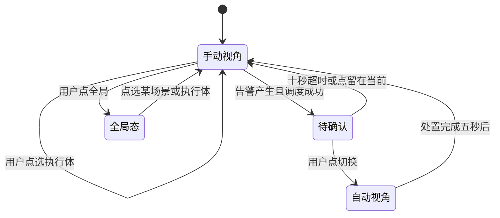

# 联动指挥演示 · 实施方案

版本：2026-11-04 定稿
前置文档：`01_对话与取舍.md`、`02_技术方案.md`
定位：`02` 是总体技术方案，本文是展台版的实施口径。两者冲突时以本文为准。

---

## 一、目标与范围

### 1.1 一句话描述

九个执行体（六台机器狗、三台人形机器人）分布在四个场景，2D 指挥图看全局态势，3D 主视角是第一人称的机器视角，可手动切换；区域告警时自动调度最近的空闲设备，并弹窗询问是否切换视角。

### 1.2 本期范围

| 项 | 内容 |
| --- | --- |
| 场景 | 森林、校园、小区、地铁，共四个 |
| 执行体 | 机器狗 6 台（森林 1、校园 3、小区 1、地铁 1），人形机器人 3 台（校园 1、小区 1、地铁 1） |
| 视角 | 第一人称机器视角为主，支持手动切换与告警联动切换 |
| 指挥图 | 2D 平面图，单场景态与全局态两种形态，实时显示全部执行体位置 |
| 事件 | 告警产生、研判、调度、到场、处置、关闭全链路 |
| 现场视频 | 告警后可调出现场真实画面，与 3D 画面互为佐证 |
| 交付 | 单文件网页，双击可开，离线可用 |

### 1.3 不在本期范围

- 真实机器狗遥控接入（现场确认暂不接入，接口预留）
- 真实安保系统对接、真实企业微信推送
- 跨场景调度（物理上不成立，禁止）
- 完整 A* 寻路（用主干道折线近似）
- 上传视频闭环（沿用现有展台页，不在本模块）

---

## 二、与 02 方案的关系

沿用 `02` 的五层架构，本模块只实现展示层，其余各层用内置演示数据模拟。

| 层 | 本期做法 | 对应章节 |
| --- | --- | --- |
| 感知层 | 预置告警剧本触发，不接真实视频 | 02 §8 |
| 事件层 | 完整实现，字段沿用 02 §4.1 | 02 §4 |
| 研判层 | 简化：等级与原因写死在事件里 | 02 §5 |
| 处置层 | 最近空闲设备 + 主干道折线路径 + 弹窗通知 | 02 §10 |
| 反馈层 | 到场、确认、关闭三态，记录时间线 | 02 §4.2 |

事件模型、设备模型直接复用 `02` 的 schema，不另立一套。原因：事件层是长期资产，地图和界面都会换，事件层要留。

---

## 三、需求定稿

### 3.1 执行体配置

| 场景 | 机器狗 | 人形机器人 |
| --- | --- | --- |
| 森林 | 1 | 0 |
| 校园 | 3 | 1 |
| 小区 | 1 | 1 |
| 地铁 | 1 | 1 |
| 合计 | 6 | 3 |

设备编号规则：`k9-<场景>-<序号>` 与 `hr-<场景>-<序号>`，均为 snake_case 前缀加短横线编号，例如 `k9-campus-02`、`hr-metro-01`。

### 3.2 视角规则

第一人称视高按设备类型区分，因为机器狗头高只有 0.72 m，直接用会产生蚂蚁视角。

| 设备 | 模型高 | 第一人称视高 | 视场角 | 说明 |
| --- | --- | --- | --- | --- |
| 机器狗 | 0.72 m | 1.15 m | 72° | 解释为云台升起后的视高 |
| 人形机器人 | 1.75 m | 1.62 m | 68° | 直接用头部高度 |

人形机器人外观定为白色圆润的 service robot 造型：乳白主体、圆角头壳、颈部一圈青色发光环、胸前状态灯、关节处深灰软性护套。理由是这类造型在展台灯光下辨识度高，也更容易让观众接受"机器人在楼里巡检"这个设定。机器狗保持参考代码的深灰加安全黄配色，与人形形成对比，远看不会混。

第一人称下需要处理两件事：

1. 隐藏自家模型，避免遮挡视野。扫描光束挂在头部节点上，要重新挂到相机节点，否则一起消失。
2. 相机加入阻尼，只保留约 20% 的步态起伏，否则长时间观看会眩晕。

### 3.3 告警弹窗规则

触发时机是调度单生成之后，不是检测到就弹。文案中的"正在前往"必须是真实状态。

文案结构：

```text
校园 · 教学楼东侧  高风险
检测到明火，置信度 97%
最近设备 K9-02 已出发 · 18 m · 约 8 秒
[ 切换视角 ]  [ 留在当前 ]
```

四条边界规则：

1. 十秒无操作自动收起为顶栏横幅，不切换视角。
2. 同时只保留一个弹窗，后来的排队；新弹窗出现时旧弹窗降级为横幅。
3. 点"留在当前"后该事件不再提示，只在 2D 图上红点闪烁。
4. 轮播模式下不弹窗，直接切换视角。

弹窗位置为屏幕顶部中央，宽度 420 px，不遮挡 3D 画面主体。键盘 `Enter` 确认切换，`Esc` 收起。

### 3.4 现场视频联动

说明：本功能不在参考代码 `xiaogou` 中，`xiaogou` 的"机载视觉识别"是模拟数据卡片，不含视频。现场视频能力来自现有展台应用的素材库与实时推理服务。

用途：3D 画面负责"态势与流程"，真实视频负责"这件事真的发生过"。两者并列时说服力最强，也正好守住"演示原型不宣称已部署"的边界，因为真实画面本身就证明了检测能力。

触发入口有三处：

1. 告警弹窗增加第三个按钮"查看现场"。
2. 识别卡片右上角增加视频图标。
3. 顶栏常驻"现场画面"按钮，播放当前选中执行体所在的最近一路画面。

播放规则：

| 项 | 规则 |
| --- | --- |
| 形式 | 预录视频片段为主，实时 MJPEG 流为辅 |
| 位置 | 右侧浮层，宽度约占屏幕三分之一，不遮 3D 主体 |
| 播放中 | 暂停 3D 渲染，避免画面争夺与性能浪费 |
| 结束 | 自动关闭浮层，恢复 3D 渲染与上一视角 |
| 标注 | 左上角固定角标"真实检测画面" |
| 缺失 | 无对应片段时按钮置灰，不弹空窗 |

素材映射：事件与视频文件通过 `src/data/media_map.json` 关联，不写死在代码里。目录沿用现有约定 `assets/media/<scene>/`，文件命名 `<event_type>_<序号>.mp4`。

编码要求：H.264 加 AAC 的 mp4，1080p 即可。H.265 与部分 mp4v 在浏览器里会黑屏，现场风险高。

降级：若使用实时 MJPEG，服务未启动时按钮置灰并提示"实时服务未连接"，不得影响其余功能。展台默认走预录片段。

### 3.5 指挥图两态

一张图装不下四个场地，因此分两态：

| 态 | 形态 | 用途 |
| --- | --- | --- |
| 单场景态 | 一张图铺满左侧面板，显示该场景全部执行体、点位、调度路径 | 讲解主用 |
| 全局态 | 四个场景缩略图排成网格，每格显示执行体位置与告警闪烁 | 总览与切换 |

全局态点击任一格进入单场景态。

执行体标记分两层信息：形状区分类型（狗 / 人形），颜色区分状态（待命灰、前往青、识别橙、告警红）。

---

## 四、架构与文件结构

### 4.1 运行形态

独立页面，工作区 `D:\Desktop\demo\command_demo\`。现有展台页保留作为兜底，从现有页面链接进入。

选择独立成页的原因：技术栈不同（现有页是 Flask 加静态前端，本模块是 Vite 加 three），合并会增加耦合；独立成页出问题时可以退回旧页面。

### 4.2 目录结构

```text
command_demo/
├─ INDEX.md
├─ package.json                three 0.169 + vite 5.4
├─ vite.config.js
├─ index.html
├─ 启动.bat
├─ src/
│  ├─ main.js                  入口
│  ├─ core/
│  │  ├─ engine.js             渲染、多场景缓存、快照俯视图
│  │  ├─ director.js           视角导演：手动、自动、弹窗、模式
│  │  ├─ world.js              执行体与事件的中央状态
│  │  ├─ app.js                流程编排
│  │  ├─ kit.js                模型库（借自 xiaogou）
│  │  └─ tex.js                程序化贴图（借自 xiaogou）
│  ├─ entities/
│  │  ├─ dog.js                借自 xiaogou，新增第一人称视锚点
│  │  └─ humanoid.js           新写
│  ├─ views/
│  │  ├─ fp.js                 第一人称相机
│  │  ├─ minimap.js            2D 指挥图，两态
│  │  ├─ prompt.js             告警切换弹窗
│  │  ├─ video.js              现场视频浮层
│  │  ├─ hud.js                顶栏、任务列表、识别卡片
│  │  └─ dash.js               成果大屏（借自 xiaogou）
│  ├─ map/
│  │  ├─ build_scene.js        地图数据转 3D 场景
│  │  └─ coords.js             像素坐标与世界坐标互转
│  └─ data/
│     ├─ agents.json           九个执行体配置
│     ├─ routes.json           各场景主干道路网折线
│     ├─ media_map.json        事件与现场视频的对应关系
│     └─ events.js             告警剧本
└─ tools/
   ├─ bundle.mjs               单文件打包
   └─ shot.mjs                 无头截图验收
```

### 4.3 与地图的边界

地图数据尚未定稿，因此本模块在 D1 到 D5 期间不写任何地图相关代码。占位方案是直接借用 xiaogou 自带的四个场景，通过一层适配器接入同一接口。

适配器只有一处判断，地图到达后替换实现即可，其余代码不动：

```js
// src/map/build_scene.js
export function build_scene(scene_id) {
  // 占位期：返回借用的场景
  // 地图到达后：由地图数据生成
}
```

这样避免了"先写一个假校园、地图到了再推倒重来"的重复劳动。

---

## 五、接口契约（冻结）

并行开发的前提是下列四个接口在 D1 定死，任何一方不得单方面修改。

### 5.1 场景模块

```js
build_scene(scene_id) -> {
  root,                      // THREE.Group，3D 场景根节点
  targets: [                 // 巡检点位
    { id, name, sev, x, y, stand_x, stand_y, cls, model, action }
  ],
  spawns: [                  // 该场景内各执行体初始站位
    { agent_id, x, y }
  ],
  extent: { cx, cz, span },  // 2D 快照的取景范围
}
```

`x`、`y` 一律使用像素坐标，与地图口径一致。像素到世界坐标的换算统一在 `coords.js` 完成，场景模块不参与。

### 5.2 执行体

```js
{
  agent_id,                  // 'k9-campus-02'
  name,                      // '巡检机器狗 02'
  type,                      // 'dog' | 'humanoid'
  scene,                     // 'campus'
  x, y,                      // 像素坐标
  heading,                   // 弧度
  status,                    // 'idle' | 'moving' | 'scanning' | 'alert'
  target,                    // 当前任务 id，无则为 null
  occupied_until,            // 占用到期时间戳，用于调度互斥
}
```

### 5.3 视角指令

```js
view.set(agent_id)                 // 手动切换
view.auto(agent_id, event_id)      // 告警联动切换
view.back()                        // 回到上一个手动视角
view.mode = 'guide' | 'kiosk'      // 讲解模式 / 轮播模式
```

### 5.4 调度

```js
dispatch(event) -> {
  agent_id,                  // 被调度的设备
  distance_px,
  eta_s,
  path: [[x, y], ...]        // 沿主干道的折线
}
```

规则：限定同场景，只选 `status === 'idle'` 的设备，按欧氏距离最近优先。无空闲设备时返回 `null`，事件降级为"待调度"，在指挥图上闪烁。

---

## 六、视角导演



要点：

- 用户手动选择后，该视角在三十秒内不被其他事件影响，只弹窗询问，不自动切换。
- 自动切换的视角在处置完成后保留五秒，然后回到用户上一次手动选择的视角。
- 轮播模式下跳过"待确认"，直接进入自动视角。

---

## 七、告警剧本

演示需要可复现的剧情，写成数据而不是散落在代码里。

三个剧本，覆盖三种等级：

| 剧本 | 场景 | 事件 | 等级 | 演示要点 |
| --- | --- | --- | --- | --- |
| S1 | 校园 | 教学楼东侧明火 | 高 | 调度最近的狗，弹窗，切换视角，到场后撤告警 |
| S2 | 地铁 | 站台人员拥挤 | 中 | 调度人形机器人，视角高，人群视野好 |
| S3 | 小区 | 电动车入楼 | 中 | 同场景两台设备，演示就近选择与占用互斥 |

每个剧本包含：事件产生时刻、位置、等级、期望调度对象、处置动作、关闭条件。剧本数据放 `src/data/events.js`。

---

## 八、排期

地图相关工作整体后移，D1 到 D5 只做与地图无关的部分。

| 天 | A 线（场景与模型） | B 线（交互与视角） |
| --- | --- | --- |
| D1 | 脚手架、搬 kit / tex / dog、场景适配器 | 第一人称相机、视角切换 |
| D2 | 多场景缓存与切换 | 多执行体重构、调度逻辑 |
| D3 | 人形机器人模型 | 2D 指挥图两态 |
| D4 | 告警剧本、事件链路 | 告警弹窗、视角导演 |
| D5 | 现场视频浮层、布局改版、性能、单文件打包、验收 | 同左 |

地图到达后追加一至两天，写 `build_scene.js` 的真实实现并替换占位，其余代码不动。

### 8.1 阶段验收点

- D2 结束：能在四个场景间切换，第一人称视角可用
- D3 结束：九个执行体在指挥图上正确显示，调度可跑通
- D5 结束：完整剧本可从告警演到关闭

---

## 九、验收标准

| 项 | 标准 |
| --- | --- |
| 启动 | 冷启动到可操作小于五秒 |
| 场景切换 | 首次小于 500 ms，之后小于 100 ms |
| 帧率 | 1080p 下稳定 55 fps 以上（RTX 5060 Laptop） |
| 全链路 | 告警到关闭全过程可复现，单次小于十五秒 |
| 稳定性 | 连续运行四小时无内存增长、无崩溃 |
| 现场视频 | 有片段的告警可播放，缺片段时按钮置灰，不弹空窗 |
| 离线 | 单文件在断网机器上双击可开 |
| 操作 | 全程可仅用键盘完成（无鼠标场景） |
| 边界声明 | 页面角落常驻"演示原型 · 场景与数据为模拟" |

---

## 十、风险

| 风险 | 影响 | 应对 |
| --- | --- | --- |
| 地图数据格式与 `map_features.json` 不一致 | 接入期返工 | 接入前先对齐字段，`build_scene` 内部做转换层 |
| 人形模型一天做不完 | 影响 D3 | 降级为简版：基础体块加行走动画，细节后补 |
| 第一人称视高过低导致地面目标不可见 | 演示效果 | 已定抬视高，D2 结束时实机验证 |
| 九个执行体同时动画 | 性能 | 只渲染当前场景，其余场景挂起 |
| 五天内做不完 | 展台无内容 | D2 与 D3 为决策门，未达标即砍功能保主线 |

---

## 十一、待确认

1. 页面对外名称与标题文案，暂定"智慧巡检联动指挥演示"。
2. 现有展台页是否需要加一个入口按钮链到本模块。
3. 现场视频素材的实际情况：现有 `assets/media/` 下各场景已有多少片段，能否与三个剧本的事件类型对应上。

---

## 十二、实施记录

### 12.1 已完成（2026-11-04）

| 方案条目 | 实现位置 | 状态 |
| --- | --- | --- |
| 九执行体（6 狗 + 3 人形） | `data/agents.json`、`core/world.js` | 完成 |
| 第一人称机器视角 | `views/fp.js` | 完成 |
| 场景缓存与切换 | `core/engine.js` | 完成 |
| 人形机器人 | `entities/humanoid.js` | 完成 |
| 2D 指挥图两态 | `views/minimap.js` | 完成 |
| 告警弹窗与超时收起 | `views/prompt.js`、`views/hud.js` | 完成 |
| 视角导演与手动锁定 | `core/director.js` | 完成 |
| 事件模型与状态机 | `core/events.js` | 完成 |
| 最近设备调度 | `core/dispatch.js` | 完成 |
| 三个告警剧本 | `data/events.js` | 完成 |
| 现场画面入口与降级 | `views/video.js`、`data/media_map.js` | 完成，素材待接入 |
| 轮播模式 | `core/app.js` | 完成 |
| 单文件打包 | `tools/bundle.mjs` | 完成，693 KB |

验证方式：无头 Edge 逐场景截图，控制台无报错；完整跑通一次告警到关闭的全生命周期，视角回退正确。

### 12.2 与方案的偏差

1. **路网仍为直线占位**。`map/routes.js` 返回两点直线。参考场景布点时人工留出了通道，直线不穿墙；换成真实校园地图后建筑是实体，必须改为路网或 A*。
2. **轮播不弹窗**按方案第 3.3 节第 4 条实现，改为直接切视角。
3. **首次进入全局态**需要补建四个场景并各渲染一张俯视快照，耗时约一到两秒，期间缩略图为空。可接受，若影响体验可在启动时后台预热。

### 12.3 已知限制

- 无头软件渲染下帧率只有三到四帧，该数字不代表真机表现，需在 5060 上实测。
- 视频素材目录为空，"查看现场画面"目前只展示空态说明。
- 调度只按距离，未考虑设备当前朝向与体力。

### 12.4 地图接入（2026-11-04 完成）

用户提供了标注版新地图（1079 × 1554），五块区域：蓝色学校、黄色道路、青绿森林、品红小区、棕色地铁站。

处理链路在 `map_trace/newmap/`：

1. `extract_zones.py` 按色相提取五块区域轮廓
2. `build_map_package.py` 把原图的 20 栋建筑按校园包围盒变换迁到新图坐标，并生成行走掩膜与地面贴图
3. 数据包拷进 `command_demo/src/map/data/`

接入后：

- 校园按真实轮廓与建筑生成，20 栋建筑按用途配色、按高度档挤出，并加楼层横带
- 寻路改为掩膜 A*，设备绕开建筑走，不再穿墙
- 森林、小区、地铁站三块按新图区域单独成场
- 2D 指挥图底图由 3D 场景离屏渲染生成，与 3D 天然一致

已知偏差：

- 新旧两图并非严格几何一致（边缘配准相关系数 0.10），建筑位置按包围盒变换近似迁移，可能有几米到十几米偏移
- 比例尺 1 像素 = 0.5 米为估算值，校园约 454 × 586 米，待实测校正
- 地面贴图源分辨率约 2 像素/米，第一人称近看偏糊，已叠高频颗粒缓解

### 12.5 演示加速

`agents.json` 中设备速度为 10 m/s（狗）与 8 m/s（人形），真实机器狗约 1.6 m/s。
按真实速度，校园内三百米调度要约三分钟，展台上无法演示，故加速。界面上不标注，
讲解时按"演示加速"口头说明即可。

### 12.6 仍未完成

- 现场视频素材（目录为空）
- 成果数据大屏
- 真实机器狗遥控接入

### 12.7 地图数据整治（2026-11-06）

观感版整改的前三项已经落地，改的是数据与渲染参数，事件层、调度层、界面均未改动：

- 过长楼体重切：目标段长 45 → 36 米，建筑 65 → 70 栋；切分脚本改为可重跑
- 切出的段渲染时按 id 收缩 2.6 米，独立楼不收缩，西北方向不再连成一道长墙
- 删除水库两侧两栋误判的「预留用地」，水库岸线与森林边界改成自然轮廓
- 删除东南角人才公寓的并集轮廓，与 p2~p6 单栋重复
- 小区范围回退到描图品红圈（7746 平方米），小区页签改画数据包里的真实楼

地铁场景加相机包围盒：轨道相机被夹在站厅内，拖拽与滚轮不再退到盒子外面。

详见 `04_观感版整改方案.md` 第九节。观感版并入主演示（方案 B）尚未开始。
