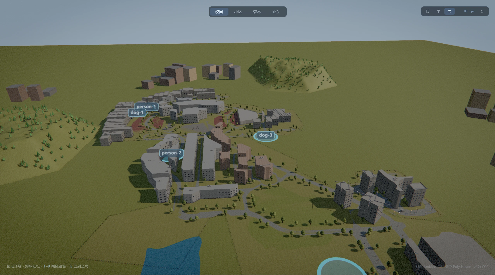
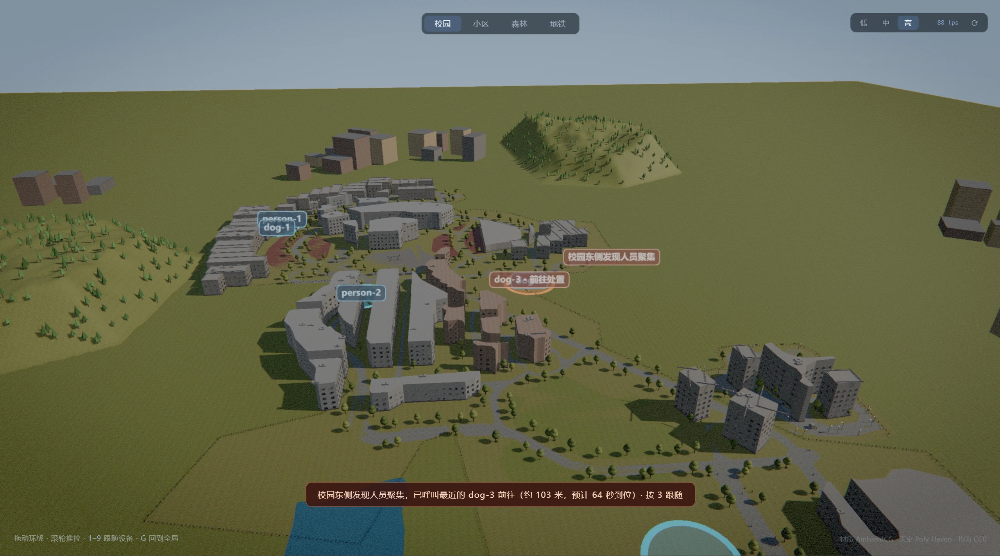
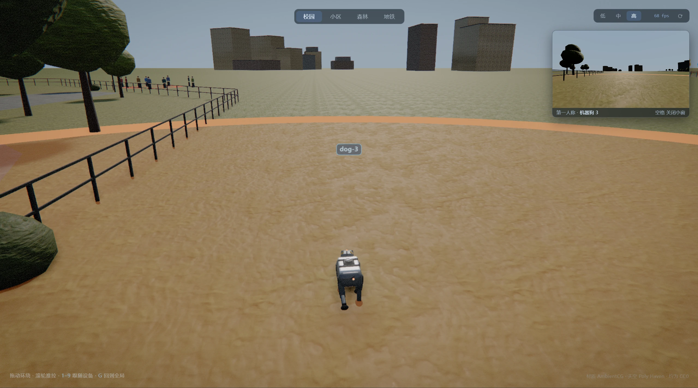
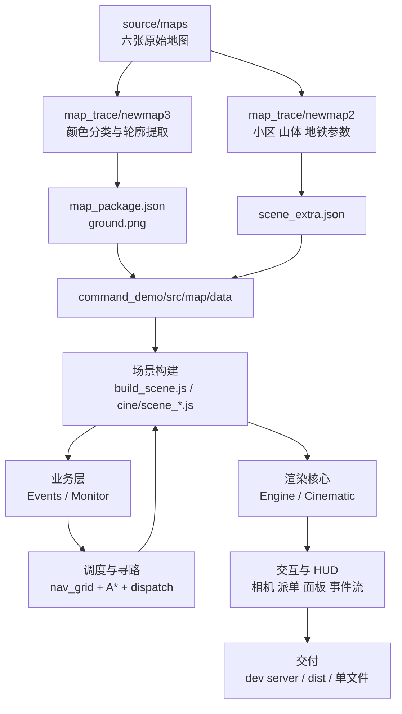
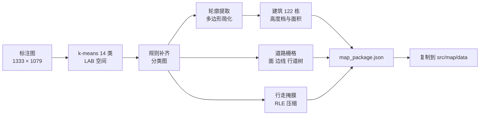
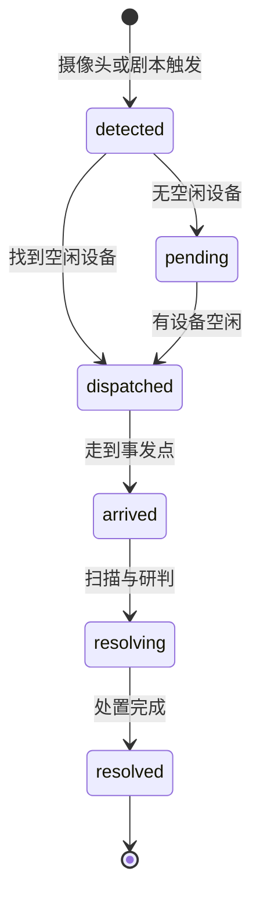
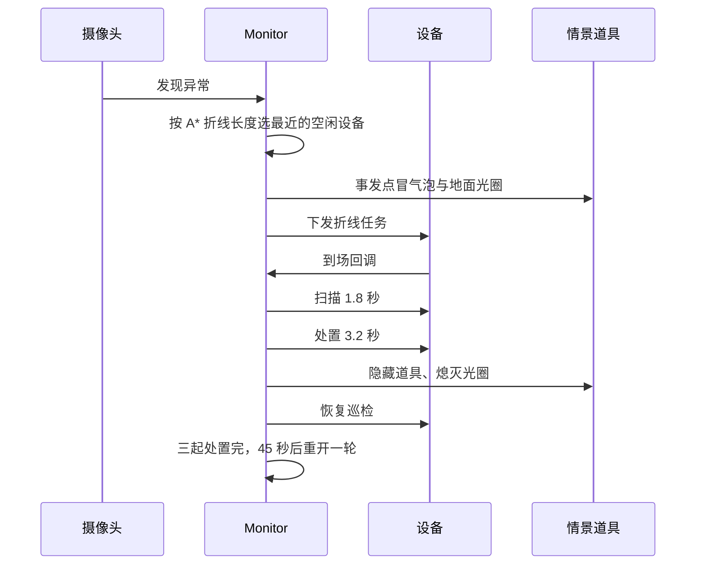

# 3D 版本技术架构

版本：2026-11-08
适用对象：接手开发的人、做技术答辩或客户答疑的人
前置阅读：`05_交接与当前状态.md`、`03_联动指挥方案.md`

本文只讲 3D 版本。最终产物是观感版 `command_demo/cinematic.html`。早期静态展示页与旧单文件构建已移入 `archive/`，不属于最终产物。

---

## 一、范围与结论

3D 版本由三个交付形态组成。

| 形态 | 入口 | 状态 |
| --- | --- | --- |
| 观感版源码 | `command_demo/cinematic.html` | **最终产物**的源码入口。四页签切换，画质优先 |
| 离线交付包 | `command_demo/观感版演示.html` | **最终交付形态**。8 MB 单文件，双击即开，断网可用 |
| 联动指挥主演示 | `command_demo/index.html` | 旧版，停用。源码保留作业务逻辑参考，不作为展示入口 |
| 旧单文件构建 | `archive/联动指挥演示_旧版_2026-11-05.html` | 留档。2026-11-05 构建，场景与地图均为旧版 |

一句话结论：**浏览器端 three.js 实时渲染，场景由离线数据包程序化生成，调度走网格 A\*。不依赖游戏引擎，不依赖外部模型文件，运行时不依赖网络。**

这个结论决定了后面所有选型。展台环境有三条硬约束：机器是笔记本，网络不可靠，现场只有几分钟讲解时间。任何需要安装、需要下载、需要预编译的方案都会被排除。

### 运行画面



*图 1　校园全局俯视。左侧执行体列表，右下事件流，地面光圈标出每台设备的状态。*



*图 2　人员聚集报警。事发点冒气泡与地面光圈，底部消息条给出距离、预计时间与派单对象。*



*图 3　第三人称跟随设备，右上角小窗是机器视角。小窗由第二个渲染器绘制。*

更多画面见 `screenshots/`。

---

## 二、总体架构



分层与职责：

| 层 | 模块 | 职责 | 不做什么 |
| --- | --- | --- | --- |
| 数据生产 | `map_trace/` 下的 Python 脚本 | 从标注图生成多边形、道路、掩膜、参数 | 不参与运行时 |
| 数据包 | `src/map/data/*.json`、`ground.png` | 场景的唯一事实来源 | 不写逻辑 |
| 场景构建 | `src/map/build_scene.js`、`src/cine/scene_*.js` | 把数据变成 three.js 对象树 | 不决定调度 |
| 渲染核心 | `src/core/engine.js`、`src/core/cinematic.js` | 渲染器、相机、灯光、后处理、帧循环 | 不知道业务 |
| 实体与运动 | `src/entities/`、`src/core/dispatch.js`、`patrol.js` | 机器狗与人形的位置、朝向、步态 | 不选目标 |
| 寻路 | `src/map/nav_grid.js`、`pathfind.js`、`routes.js` | 可行走网格、A\*、折线简化 | 不关心谁在走 |
| 业务 | `src/core/events.js`、`src/cine/monitor.js` | 发现、派单、到场、处置、关闭 | 不直接改模型 |
| 视角 | `src/core/director.js`、`src/views/fp.js`、`cinematic.set_follow` | 谁看哪里、什么时候切换 | 不决定派谁 |
| 界面 | `src/views/`、`src/cinematic_main.js` | 面板、事件流、弹窗、按键 | 不做状态判断 |

模块之间的依赖是单向的。业务层只调用 `route()` 与实体的公开方法，不碰场景内部。这条约束让换地图、换渲染层、换业务层可以分开做。

---

## 三、技术选型

### 3.1 选型表

| 需求 | 选择 | 主要备选 | 选它的理由 |
| --- | --- | --- | --- |
| 3D 渲染 | three.js 0.169 | Unity WebGL、Unreal、Godot、Babylon.js、Cesium | 浏览器原生、体积可控、源码可读、迭代以分钟计。展台机器是 Windows 笔记本，WebGL2 足够 |
| 构建 | Vite 5.4 | webpack、Parcel | 冷启动快，开发时改一个文件几百毫秒生效；构建可内联全部资源 |
| 应用框架 | 无，原生 ES 模块 | React、Vue | 界面只有几个面板与列表，状态由业务层持有。引入框架只会多一层同步 |
| 地图生产 | Python 3 + OpenCV + NumPy | 手工建模、GIS 工具 | 标注图是位图，颜色分类、轮廓提取、栅格化都是现成算子 |
| 寻路 | 自写网格 A\* | navigation mesh、第三方库 | 场景是二维平面加高度，网格足够；自写便于加两套可行走规则与视线简化 |
| 材质 | `MeshStandardMaterial` / `MeshPhysicalMaterial` | 自定义 shader | 物理材质与 PMREM 环境光配合，反射与粗糙度可信，不必自己写 BRDF |
| 后处理 | three/addons 的 EffectComposer | 自写管线 | GTAO、Bloom、SMAA 都是现成 pass，参数够用 |
| 验收 | puppeteer-core + 本机 Edge | Playwright、人工截图 | 只做截图与读控制台，不引入浏览器下载；本机已有 Edge |
| 素材 | AmbientCG、Poly Haven，CC0 | 商业素材库、自建摄影测量 | 许可干净，可离线分发；CC0 不必署名也能用 |
| 数据格式 | JSON + PNG | 二进制、数据库 | 可直接读、可直接 diff，换图只换文件 |

### 3.2 为什么不用游戏引擎

这是整个项目最关键的一次取舍。

Unity WebGL 与 Unreal 的像素质量更高，但代价是：安装编辑器、导入素材、烘焙、构建，一轮改动以小时计；产物体积从几十 MB 起；团队要同时维护引擎工程与网页壳。展台版只有一周时间，且需求在第二天仍在变。

Godot 更轻，但同样要面对资产导入与导出链路。项目真正缺的不是渲染能力，而是**场景数据**。引擎不会替你从一张总平面图里长出 122 栋楼、8 米宽的道路和可行走掩膜。

因此选择把工程量放在数据链路上，渲染交给 three.js。代价是画质上限低于 3A，收益是换一张地图只需重跑脚本，不用重做工程。

### 3.3 为什么不用 GLB 模型

场景里的楼、树、路灯、护栏、列车、机器狗全部由代码生成，没有外部模型文件。

原因有三条。第一，地图数据每天都在变，模型要先建模再摆位，数据一改就要返工。第二，Objaverse 一类公开模型库没有可靠的分类元数据，按类型筛选的成本高于程序化生成。第三，单文件交付要求所有资源可内联，外部模型会让包体失控。

程序化几何的短板在近景。窗框、女儿墙、勒脚、屋顶机组能撑住中远景，贴到两米内仍然像玩具。这一条写进了待优化项。

---

## 四、渲染架构

项目里有两套渲染核心，服务两种目标。

### 4.1 Engine 与 Cinematic

| 项 | Engine（主演示） | Cinematic（观感版） |
| --- | --- | --- |
| 文件 | `src/core/engine.js` | `src/core/cinematic.js` |
| 目标 | 一秒能开，离线能跑 | 展台大屏，允许吃满 RTX 5060 Laptop |
| 色调映射 | ACESFilmic，曝光 1.02 | AgX，曝光 0.88 |
| 环境光 | 程序化摄影棚预设，PMREM 立方体 | Poly Haven 全景图，PMREM 预过滤 |
| 阴影 | PCFSoft，2048 | PCFSoft，1024/2048，每帧重绘 |
| 后处理 | 无 | MSAA 4× 目标 → GTAO、Bloom、调色、OutputPass、SMAA |
| 场景管理 | 四场景常驻缓存，切换只换根节点 | 一次只建一个场景，切换时销毁重建 |
| ticker | 按场景归属，非活动场景不执行 | 单场景，切换时整体清空 |
| 相机 | OrbitControls + 第一人称接管 | 轨道相机 + 跟随相机 + 第二渲染器小窗 |
| 用途 | 联动指挥、事件状态机、2D 指挥图 | 展台主画面、讲解面板、点击派单 |

两套核心共享实体、寻路、调度推进与数据包，差别只在渲染与相机。

### 4.2 Cinematic 的后期管线


参数与理由：

| 环节 | 关键参数 | 为什么 |
| --- | --- | --- |
| AgX | 曝光 0.88 | ACES 高光发白、饱和度冲；AgX 高光过渡更缓，接近影视标准 |
| GTAO | 半径 0.6、8 采样、厚度 1.2 | 墙角、栏杆根、树根变暗。没有 AO 的场景像塑料 |
| Bloom | 强度 0.22、半径 0.55、阈值 0.92 | 只让窗光与高光轻微溢出，过强会脏 |
| Grade | 暗角 0.35、色差 0.0012、颗粒 0.022 | 只加质感，不加滤镜 |
| SMAA | 默认保留 | 只修「已经画出来的边」；亚像素窗格/贴地线条交给下面的 MSAA 渲染目标 |

### 4.3 光照与阴影

主光是一盏方向光，色温偏暖，强度 3.4。补光是一盏半球光，天空冷、地面暖，强度 0.28，避免背光面死黑。环境反射来自 PMREM 预过滤的全景图。

阴影相机覆盖 ±130 米，2048 贴图，`normalBias` 0.06。场景不在原点时，光的 target 与阴影相机要一起挪过去，否则阴影整个丢失。观感版用 `focus_sun(center, radius, azimuth)` 统一处理，方位角取相机方位加 1.15 弧度，保证朝向镜头的墙面受光。

**阴影每帧重绘。** 曾为省一半阴影 pass 改成隔帧 `needsUpdate`，机器人/行人的影子在 30 Hz 上跳，大屏上看着就是「地面在抖」；实测只省约 20% 帧时间，不值得。

**抗锯齿是 MSAA 4× + SMAA 两级。** 渲染器本身 `antialias:false`，场景先渲进一张 `samples: 4` 的 HalfFloat 渲染目标（`EffectComposer(r, hdr)`），再做 GTAO/Bloom/调色，最后 SMAA。只有 SMAA 时，远景窗格、贴地线条这类亚像素几何在相机慢转时会爬行、发毛刺——这是「3D 闪」的主因。4× 在 1600×900 下约多花 20% 帧时间（RTX 5060 Ti：78 → 62 fps）；四核以下默认退 2×，`?msaa=0/2/4` 可现场覆盖。

**没有使用 CSM 级联阴影。** 实测 CSM 的 `setupMaterial` 会重写材质 shader 片段，与玻璃、清漆、环境反射叠加后，窗面被洗成浅灰，阴影同时消失，而且不报错。场景只有两百米见方，单张 4096 阴影足够。

### 4.4 材质与贴图

素材是 AmbientCG 的 12 套 CC0 材质，每套四通道：Color、Normal、Roughness、AO。原图 1024 压到 512，转 WebP；全景天空压到 2048。成品合计 5.4 MB，放在 `public/cinematic/`。

三条必须遵守的规则。

**一、先预载，后建景。** `await preload([...])` 必须在构建场景之前完成。材质在创建时就去缓存里取贴图，取不到会退化成纯色；着色器编译过之后，再补贴图也来不及。

**二、UV 单位不能混用。** `ShapeGeometry` 与 `ExtrudeGeometry` 的 UV 单位是米，`BoxGeometry` 与 `PlaneGeometry` 是 0 到 1。混合使用会把贴图铺成几十次一米的噪点。统一口径：前者 `repeat = 1 / 贴图米数`，后者 `repeat = 面尺寸 / 贴图米数`。长宽差别大的盒子要分别给 `[u, v]`。

**三、`repeat` 不进贴图缓存键。** 缓存按 `slug/channel` 建，材质创建时克隆贴图再设 `repeat`。按 `slug/channel/repeat` 缓存会导致改一个 repeat 就取不到纹理，整个场景退化成白模。克隆共享 `texture.source`，three 的 WebGLTexture 按 source 缓存，不额外占显存。

**并发限制。** 预载内部按 8 个一组限流。四百多张同时发会打满浏览器连接池，`TextureLoader` 的 `onError` 会全部触发。实测 442 张全部失败，单张加载却正常。

### 4.5 天空与雾

背景是程序化渐变天空，不是全景照片。实拍全景自带另一套建筑与地平线，与近处 3D 尺度对不上，远看像两张图拼接。全景图只用于环境照明与反射。

雾色取地平线颜色，地面一路淡出到天空，没有接缝。

### 4.6 性能策略

观感版初版有 3112 个独立网格。三角形只有 4 万，几何量很小，但三千次绘制调用把 CPU 压垮，帧率掉到个位数。处理分四步。

| 手段 | 效果 | 代价 |
| --- | --- | --- |
| `merge_static` 按材质合并静态几何 | 广场 3112 → 27 个网格，小区 1984 → 29 个 | 合并后不再按视锥剔除，`frustumCulled = false` |
| `InstancedMesh` 画树与轨枕 | 211 棵树加 71 丛灌木只占 4 次调用 | 单个实例不能独立改几何 |
| `userData.no_merge` 跳过动画子树 | 列车、设备、行人保持可动 | 多一层祖先检查 |
| 画质档位 | 低、中、高三档，默认中 | 高画质要更强的 GPU |

画质档位：

| 档位 | 像素比 | GTAO | Bloom | SMAA | 阴影 |
| --- | --- | --- | --- | --- | --- |
| 低 | 1.0 | 关 | 开 | 关 | 1024 |
| 中 | 1.2 | 开 | 开 | 开 | 2048 |
| 高 | 1.5 | 开 | 开 | 开 | 2048 |

MSAA 采样数不跟档位走，跟机器核数走（≤4 核 2×，否则 4×），`?msaa=` 可覆盖——档位切的是像素比与阴影，改采样数要重建渲染目标。`devicePixelRatio=1` 的展台屏上三档都按 1× 渲，所以抗锯齿不能指望像素比。

默认按 CPU 核数与视口像素自动选。页面上有实时帧率，用墙钟统计，不用累计 `dt`，否则低帧率时数字虚高。

仿真时间 `dt` 上限 0.05 秒。低帧率时仿真放慢，而不是跳帧。这样机器不会一帧瞬移穿过目标点。

---

## 五、场景与地图数据

### 5.1 数据包

`map_package.json` 是场景的唯一事实来源。

| 字段 | 内容 | 当前规模 |
| --- | --- | --- |
| `image` | 图幅与源图名 | 1333 × 1079 |
| `scale` | `meters_per_px` 与说明 | 1.0 米/像素，依据见 `note` |
| `zones` | 五个区域的多边形与包围盒 | campus、road、forest、community、subway |
| `buildings` | 建筑多边形、类型、高度档、面积 | 122 栋 |
| `roads` | 面、边线、行道树、灌木 | 路宽 8 米，边线 0.3 米，160 棵树 |
| `walk_mask` | 行走掩膜，RLE + Base64 | 667 × 540，每格 2 像素 |

`scene_extra.json` 是补充参数，由 `newmap2` 的脚本生成，前端仍在读。

| 字段 | 内容 |
| --- | --- |
| `community` | 小区环路、中轴、楼栋、车棚、道闸 |
| `hills` | 东西两山的轮廓与山脊线 |
| `subway` | 站厅尺寸、站台高度、轨道与列车参数 |
| `forest` | 森林轮廓、林间道路、空地范围 |

`ground.png` 只画铺装、绿化、水与森林，不画道路。道路是独立几何体，白色边线在 y=0.06，沥青面在 y=0.14，两层拉开 8 厘米，避免远处俯视出现黑白条纹。

### 5.2 坐标系统

数据层与接口层一律使用像素坐标。世界坐标只在 `src/map/coords.js` 里出现。

```text
世界坐标：x = (px - W/2) × meters_per_px
          z = (py - H/2) × meters_per_px
```

原点取图幅中心，three.js 的地面是 x-z 平面。地图换版只换数据包，代码不动。

这条约定带来一个必须遵守的纪律：**任何模块都不许自己写像素到世界的换算**。一旦有人绕过 `coords.js`，两套坐标就会漂移，表现为点击派单落到错误位置、设备站到楼顶。

### 5.3 两套场景构建

| 项 | 主演示 | 观感版 |
| --- | --- | --- |
| 入口 | `src/map/build_scene.js` | `src/cine/scene_campus.js` 等四个文件 |
| 材质 | 程序化贴图 | 真实 PBR 贴图 |
| 建筑 | 数据包多边形直接挤出 | 挤出加勒脚、女儿墙、窗、屋顶机组，居民楼先经 `rectify.js` 方正化 |
| 道具 | 少 | 树、路灯、长椅、垃圾桶、护栏、汽车 |
| 行人 | `crowd.js` | `crowd.js` 加 `life.js` 的情景道具 |
| 小区 | 独立场景 | 由 `add_community()` 挂进校园场景，两个页签共用一份数据 |
| 森林 | 独立场景，按森林多边形撒树 | 校园场景同样消费森林多边形，补西侧森林带；远景楼避让林地 |

小区与校园在新图上是同一张图里的两块地。观感版让校园场景直接调用 `add_community()`，页签切换只换机位。这样两块地严丝合缝，不必维护两套坐标。

### 5.4 地形

`src/map/terrain.js` 按多边形生成高度场。

```text
高度 = 边界过渡 × 山脊钟形 × 分形噪声
```

山脚平滑归零，巡检空地通过 `flatten` 参数压平，向四周 45 米缓坡过渡。否则地形会从空地底下顶起来，设备走在坡里。

两个必须记住的坑。第一，高度按世界坐标计算，网格本体必须 `mesh.position.set(wc.x, 0, wc.z)`，否则整座山堆到图幅原点。第二，坡面撒树用的是网格局部坐标，落地时要补 `mesh.position` 偏移，否则树全飞到原点附近。

### 5.5 地图生产链路



数据是生成物。`map_package.json`、`ground.png`、`scene_extra.json` 都有对应脚本，不许手改。改完楼体必须重跑 `fix_road_conflict.py`；改完轮廓必须重跑 `reshape_terrain.py`。完整顺序见 `04_观感版整改方案.md` 第 9.4 节。

脚本运行顺序：

```text
当前主链路（newmap3）
build_package.py

历史全量重建链路（换旧图或重排小区时才跑）
newmap/build_map_package.py → newmap/build_roads.py
→ newmap2/split_long_buildings.py → newmap2/expand_community.py
→ newmap2/enrich_community.py → newmap2/reshape_terrain.py
→ newmap2/fix_road_conflict.py
```

---

## 六、寻路、执行体与调度

### 6.1 可行走网格

`src/map/nav_grid.js` 在启动时按多边形栅格化，扫描线填充，生成两套网格。

| 网格 | 谁走 | 范围 |
| --- | --- | --- |
| `all` | 机器狗 | 建筑、水面、轨道之外都行 |
| `road` | 人形机器人 | 只走道路与站台面 |

网格尺寸来自数据包的 `walk_mask.div`，当前每格 2 像素。按 1.0 米/像素算，一格 2 米。网格在 JS 里现场生成，不预生成到 Python：小区与地铁的几何是前端拼出来的，参数一改网格要跟着变。

### 6.2 A\*

`src/map/pathfind.js` 是八邻接网格 A\*，对角线代价 √2。找到路径后做视线简化，去掉锯齿折线。

三条行为约定：

1. **拿不到路径返回 `null`，绝不退回直线。** 直线会穿楼、穿轨道、翻山，这正是早期「机器从楼里穿过去」的来源。调用方拿到 `null` 只提示、不移动。
2. **起点吸附要补进总长。** 人形只走 road 网格，起点会吸附到最近的路格心。这段距离不在折线里，不补的话实际二十米被报成五米。
3. **终点容差 1.2 米，中间点 0.5 米。** 早先终点按 0.4 米，实体自己的到达阈值是 0.28 米，两者不一致会在「我认为到了」和「这里认为没到」之间来回切，表现是到点后原地打转。另有 3 秒卡住兜底。

### 6.3 执行体

`Dog` 与 `Humanoid` 提供同名接口：`position`、`heading`、`setFirstPerson`、`viewYaw`、`viewPitch`、`walkTo`、`stop`、`startScan`。调度与视角代码不区分类型。

| 参数 | 机器狗 | 人形 |
| --- | --- | --- |
| 视高 | 1.15 米 | 1.62 米 |
| 视场角 | 72° | 68° |
| 演示速度 | 10 m/s | 8 m/s |
| 真实速度 | 约 1.6 m/s | 未实测 |

演示速度是加速值，目的是让调度在十几秒内完成。对外讲解时必须说明，不能当成实测性能。

狗不抬视高会是蚂蚁视角，地面目标看不清，所以第一人称视高定在 1.15 米。

### 6.4 巡检

`src/core/patrol.js` 让空闲设备自己走。规则是：从场景航点里挑一个较远的点走过去，到点停 2 到 5 秒再挑下一个；告警调度时立刻让位；巡检期间 `status` 仍是 `idle`，随时可被派单。

航点用最远点采样 `spread_spots()`，不是「按开阔度排序再卡最小间距」。后者会把四台设备全挤在同一片空地，看起来像堆在一起。

### 6.5 调度

两套业务层的调度口径不同。

| 项 | 主演示 `dispatch.js` | 观感版 `monitor.js` |
| --- | --- | --- |
| 距离 | 欧氏距离 | A\* 折线长度 |
| 候选 | 同场景、`status === idle` | 同页签、`status === idle` |
| 失败 | 返回 `null`，事件停在待调度 | 全部不可达时停在待派，5 秒后重试 |

观感版按折线长度更合理。直线近但中间隔着楼，机器走不过去。主演示沿用早期口径，没有改，属于待优化项。

设备上有两个字段参与调度：`status`（idle、moving、on_site、busy）与 `task`。有 `task` 时，`robots.step()` 不再自己挑航点，走完折线回调 `task.on_arrive()`。绕开这两个字段另写一套，会出现两边同时改方向。

### 6.6 行人

`src/core/crowd.js` 负责氛围与事件支撑。校园 18 人、小区 12 人、地铁 12 人、森林 1 人，都只在可行走网格上活动，人形走 road 网格。

人员密度告警的点位另有 `crowd_cluster`，摆一圈静止的人。否则画面空无一人却说检测到拥挤，讲解说不通。

地铁站台比地坪高 0.9 米。设备、行人、摄像头、地面光圈全部要按 `floor_y` 抬起来。少抬一处就露馅：行人腿埋在台面里，看起来只有上半身。

---

## 七、业务层

### 7.1 主演示事件状态机

`src/core/events.js` 绑在 `World` 上，负责完整的事件生命周期。



事件字段沿用 `02_技术方案.md` 第 4.1 节。状态机与渲染解耦，换地图、换界面都不影响事件层。

### 7.2 观感版监控层

观感版没有 `World`，主演示的事件层用不上。`src/cine/monitor.js` 只做最小一层。



报警不抢镜头。事发点冒气泡、底部弹消息条，按数字键才跟上去。这条规则来自 `03_联动指挥方案.md`：展台上讲解讲到哪，画面不能被报警抢到哪。

道具只建一次，靠显隐复位。明火与烟柱在 `kit` 里注册了逐帧 ticker，删掉网格不会注销 ticker，循环报警每轮重建会越攒越多。

### 7.3 两套业务层为什么没有合并

主演示的事件层依赖 `World` 的执行体清单与场景缓存。观感版是单场景、无 `World`、设备由 `robots.js` 局部持有。强行合并会把两套生命周期绑在一起，改动风险高于收益。

代价是重复。同一条「发现、派单、到场、处置」的逻辑写了两遍，口径已经开始分叉，例如距离算法。这是待优化项里优先级较高的一条。

### 7.4 文案与区域命名

- 校园与小区按楼名取名：离楼脚 15 米内的最近一栋，加方位。
- 森林与地铁退回场内方位：「西山林区东侧」「地铁站厅」。跨场景套校园楼名会串味。
- 报警文案：`<区域>发现<问题>，已呼叫最近的 <设备> 前往（约 N 米，预计 N 秒到位）`。

---

## 八、交互设计

### 8.1 相机

观感版有三种相机状态。

| 状态 | 操作 | 实现 |
| --- | --- | --- |
| 自由轨道 | 拖动环绕、滚轮推拉 | 球坐标，角度与距离朝目标插值，阻尼按 60fps 校准 |
| 跟随设备 | `1` 到 `9` | 第三人称在设备后上方 5.2 米、抬 2.2 米；第一人称按视高 |
| 全局俯视 | `G` 或 `Esc` | 仰角 1.02 弧度，总平面转 90° 对齐 16:9 |

拖动使用「本次事件减上次事件」的增量，不是「本次减按下点」的累计值。累计值叠加到上一次角度上会越拖越冲。

右上角小窗是第一人称，用第二个渲染器画同一棵场景，渲染时机身临时隐藏。主渲染器带后期管线，在同一渲染器里用视口裁切画第二视角会破坏后期链。

地铁站厅是封闭盒子，相机要按 `root.userData.frame.cam_clamp` 夹在内部，留 4 米余量。否则会退到盒子外看到天空。

跟随相机目前没有墙体避让，设备贴墙时第三人称机位可能进墙。

### 8.2 点击派单

射线打到地平面，换算成像素坐标，派最近的空闲设备。地铁的地平面要按 `floor_y` 抬高，否则点哪儿都落到台面下面。

拖动超过 6 像素或按住超过 0.6 秒不算点击，所以转视角不会误派。正在跟随某台设备时，优先派它自己；它不忙才退回最近的。讲解时「点哪儿它去哪儿」最直观。

### 8.3 面板与大屏

左侧执行体列表显示状态与跟随入口，右下事件流按时间戳记录发现、派单、到场、处置，最多八条。`H` 收起左右面板，接大屏时只留画面。

面板刷新按墙钟 250 毫秒节流，不能用 `dt`。`dt` 有上限，低帧率时界面会显得卡住。

#### 现场抓拍卡

报警时在事发点上方弹一张实拍照片，13 秒后自动收起，同时最多两张。卡片用 `CSS2DRenderer` 挂在世界坐标上（`views/evidence.js`），照片按场景与异常类型从 `public/photos/` 取（`data/evidence.js` 的 `EVIDENCE_PHOTOS`），单文件版从 `window.__INLINE_ASSETS` 里取同一张。

手机页的「用演示照片」读同一批图的 `public/photos/photos.json`（`caption` 直接当上报位置），所以手机里预览的图、上报的区域、地图上弹出的卡是同一套素材，讲解时前后对得上。删了 `photos.json` 手机那个按钮会置灰、上报整条流程走不通——`npm run check:live` 卡在「回执卡没出现」多半是这里。

两个边界必须处理：事发点靠近画面上沿时卡片会顶进标题条，所以首帧量 `getBoundingClientRect()`，`top < 190` 就把卡片翻到引线下方；靠近左右面板时按 `safe_l = 404`、`safe_r = 视口宽 - 396` 横移卡片，引线仍落在事发点。

照片是展台素材，不是推理输出。为了让图与事件对得上，异常类型扩到七类（ire 明火 / smoke 违规吸烟 / crowd 人员聚集 / 	rash 垃圾堆积 / hydrant 消防栓异常 / xt 灭火器异常 / xit 疏散通道堵塞），data/evidence.js 按「场景 × 类型」登记照片，同一类型有 2–3 张时按事发点做稳定哈希轮换；每个场景只报本地真有照片的类型（mobile/contract.js 的 SCENE_MODELS[*].alert_kinds），没登记的类型宁可不弹卡，也不拿垃圾照去配消防栓。新增类型要同步三处：contract.js 的 KIND_META、cine/monitor.js 的 KIND_NAME、	ools/alert_bus.mjs 的 KINDS/KIND_LEVEL——漏了服务端会 400，事件不会落盘也不会回放。

画面内容与报警类型是「类型匹配」，不是同一台摄像头拍到的因果证据，讲解时不要指着照片说「这就是模型看到的画面」。

`CSS2DRenderer` 在本轮之前只有旧引擎 `engine.js` 有，大屏的 `Cinematic` 没有；补 `labelRenderer` 后每帧在后期链之后渲染一次，只增加 DOM 节点，不占 draw call。

### 8.4 为什么不做 2D 指挥图

主演示有 2D 指挥图，底图由 `engine.snapshotTopDown` 从 3D 场景离屏渲染生成，与 3D 天然对齐。观感版最终没有做，理由是 3D 俯视加点击派单已经够用，再维护一张平面图只会增加两套数据对不齐的风险。

---

## 九、构建与交付

### 9.1 开发

```bash
cd command_demo
npm install
npm run dev
```

Vite 绑定 `0.0.0.0`，局域网里的手机或第二台电脑也能打开。端口 5179，固定不漂移。根地址 302 到观感版，避免有人打开根路径看到另一套旧画面。`/index.html` 不做重定向，主演示从这里进；早先连它一起跳走，导致主演示在开发服里没有入口，验收脚本也打不开。

`vite.config.js` 里有三个入口：`index.html`、`cinematic.html` 与 `mobile.html`。监听只覆盖源码树，避开 Windows 上编辑器临时目录导致的 EBUSY。

开发服里还挂了一块**本机联动总线**（`tools/alert_bus.mjs`，Vite 插件，只在 dev / preview 生效）：
大屏把告警状态机的事件 POST 到 `/api/alerts`，手机预警页订阅 `/api/alerts/stream`（SSE）。
它没有引入新进程，事件日志存在内存里（最近 500 条），手机后连上时按日志回放补齐状态。
部署版配了 `BUS_STATE_FILE` 后同一份日志还会落盘（300 ms 防抖、原子写），刷新页面或重启容器都能接着上一场，
大屏启动时会把最近 8 条回放进事件流；开发服不配这个变量，行为与纯内存一致。详见 `12_公网部署.md`。
`/phone` 302 到 `mobile.html`；`/api/alerts/info` 返回本机局域网 IPv4 供大屏生成二维码。
总线还提供观众互动通道：`/api/commands`（观众上报、语音指挥）、`/api/participants`
（值班员角色/积分）、`/api/stats`（本场战报）、`/api/frames`（机器狗第一视角回传帧）。
数据链路与契约见 `07_移动预警接收页.md`；界面与互动见 `10_AEGIS界面重设计.md`。
单文件离线包没有这个服务，手机页会自动落到演示模式。

### 9.2 单文件

最终交付物是 `command_demo/观感版演示.html`，由 `npm run bundle` 生成。

构建分两步。第一步用 `vite.single.config.js` 单独构建观感版，只留一个入口并开启 `inlineDynamicImports`。主配置有三个入口，Rollup 会把共用的 three 与场景代码拆成独立 chunk，行内模块无法再 import 外部 chunk，所以单文件构建必须与主构建分开。

第二步由 `tools/bundle.mjs` 完成三件事：

1. 把 `assets/` 下的 JS 与 CSS 替换成行内标签。
2. 把 `public/cinematic/` 下的贴图与天空图、以及 `public/photos/` 下的 13 张现场照转成 `data:` URI，注入 `window.__INLINE_ASSETS`，键与源码里的相对路径一致。`pbr.js` 的 `asset_url()` 与 `data/evidence.js` 的 `photo_src()` 优先查这张表，查不到才退回 `document.baseURI`。
3. 内联 favicon，并检查是否还有 `./assets/` 残留外链。

贴图必须走 data URI，不能直接读 `file://` 下的本地图片。浏览器把每个本地文件当成独立源，WebGL 上传纹理时会触发跨源限制，画面退化成纯色，控制台还不一定报错。`asset_url()` 就是为这条限制加的入口。

成品 10.3 MB，内联 69 个素材，`file://` 打开四个场景贴图解码正常、现场抓拍卡能出图，控制台无报错。验收脚本 `tools/checks/file_check.mjs` 不加 `--allow-file-access-from-files`，按展台双击的真实条件跑。

### 9.3 验收

验收脚本在 `command_demo/tools/checks/`，说明见该目录 README。做法是用 puppeteer-core 启动无头 Edge，截图并收集控制台报错。

必须知道的限制：无头软件渲染只有 1 到 5 帧。仿真时间每帧最多累加 0.05 秒，等墙钟推不动仿真。涉及时间的验收要直接改 `engine.time`。截图里的帧率不代表真机表现，需要在 RTX 5060 上实测。

---

## 十、设计思路

按重要性排列，每条都是一次判断，不是偏好。

**1. 用浏览器，不用游戏引擎。** 展台机器是笔记本，网络不可靠，讲解窗口只有几分钟。Web 应用双击即开，改一行刷新就见效。代价是画质上限，收益是迭代速度与部署确定性。

**2. 场景由数据生成，不手工摆放。** 手工摆放的代价不在第一次，而在第二次改图。数据驱动之后，换图是重跑脚本，不是重建工程。

**3. 程序化几何加真实 PBR 材质。** 形状由代码生成，质感由贴图承担。这是「没有建模预算但要看起来真实」的唯一可行组合。近景仍然不足，但中远景已经能撑住展台距离。

**4. 预计算为主，实时为辅。** 现场网络与算力都不可控。检测结果预先算好，实时推理只作为加分项，失败也不影响主线。

**5. 三种视角各司其职。** 第一人称建立代入感，第三人称看清动作，俯视交代全局。视角切换必须可控，不能由报警抢占。

**6. 报警不抢镜头。** 手动选择后三十秒内不自动切视角，只弹窗询问。展台讲解的连续性比信息及时性更重要。

**7. 单一事实来源。** 坐标只在 `coords.js` 转，场景只在 `build_scene()` / `add_community()` 建，路径只从 `route()` 出。任何第二套实现都会漂移。

**8. 没有路径就不动。** 宁可停下提示，也不退回直线。穿楼的画面会立刻摧毁可信度，停住只是不够流畅。

**9. 拟真可以，声称已部署不行。** 大屏标注「演示原型 · 场景与数据为模拟」。机器狗是遥控节点，不宣称自主导航。这条边界写进所有对外材料。

**10. 成本花在数据链路，不花在渲染参数。** 画质调到 80 分只要两天，从 80 到 90 要两周。数据链路每省一天，换图能力就多一分。

---

## 十一、可扩展性

### 11.1 换一张地图

改动集中在数据层，前端代码不动。

1. 把新图放进 `source/maps/`。
2. 改 `map_trace/newmap3/build_package.py` 的 `SRC`，跑脚本。
3. 产物覆盖 `command_demo/src/map/data/`。
4. 重跑 `tools/checks/_smoke.mjs` 与 `_alert_probe.mjs` 验收。

现状成本约一周，其中四天是数据生产。瓶颈在描图、道路、建筑与小区排布，不在渲染。

### 11.2 加一个场景

场景契约已经冻结，见 `03_联动指挥方案.md` 第 5.1 节。新增场景要实现：

```text
build_scene(scene_id) -> { root, targets, spawns, extent, env, name, title }
```

观感版另有一套 `build_xxx(root)`。新增页签要同时补：可行走网格、航点、摄像头点位、行人数量、机位、区域命名规则。

### 11.3 加设备

主演示在 `src/data/agents.json` 加一条，`build_scene` 的 `spawns` 按场景内顺序分配位置。观感版改 `add_robots` 的 `dogs` 与 `humans` 数量。

两种设备共用接口，新设备只要实现同名方法即可接入调度与视角。

### 11.4 接真实视频与推理

接口已留好，素材目录为空：

- `src/data/media_map.js` 把事件映射到视频路径。
- `src/views/video.js` 是现场画面浮层，无素材时展示空态。
- `archive/visual_inspection_demo/tools/live_server.py` 是 Flask 加 OpenCV 的 MJPEG 服务，支持 `.onnx` 与 `.pt`。该工程已归档，接口可复用。

接真实流时把 MJPEG 地址填进 `media_map`，浮层直接播放。降级路径不变：取不到流就显示空态说明。

### 11.5 接真实机器狗

机器狗能遥控行走、有摄像头，不能自主导航。可接的部分是遥测与视频：

1. 写一层适配器，把真实位姿换算成像素坐标，写进设备的 `position` 与 `heading`。
2. 状态保持 `status` 与 `task` 两个字段，调度逻辑不用改。
3. 视频走 `media_map`。

不能接的部分是自主导航。对外只能表述为「遥控移动节点参与调度」。

### 11.6 换渲染层

`Cinematic` 的公开面只有 `bind_orbit`、`set_follow`、`set_sky`、`load_sky`、`set_quality`、`snapshot`。业务层不依赖后处理与材质细节，换渲染实现不会波及业务。

### 11.7 大屏与多机

展台优先用单文件包，双击即开，不依赖网络与服务。开发服务绑定 `0.0.0.0`，局域网可访问；需要多机同步画面时才用一台跑服务、另一台接大屏。无人值守时 `H` 收起面板，只留画面。

### 11.8 规模上限

当前场景在 1.3 公里见方、九百多个网格（合并后）时靠合并与实例化维持帧率。再上一个数量级需要：网格 A\* 挪进 Worker、静态几何分块、远景 LOD、贴图按距离降级。这些都没有做。

---

## 十二、待优化项

按优先级排列。P0 影响正确性或交付，P1 影响维护成本，P2 影响观感与上限。

### P0

当前无遗留。2026-11-10 已解决三条：

| # | 原问题 | 处理 |
| --- | --- | --- |
| 1 | 比例尺口径不一致：`meters_per_px` 实际 1.0，`scale.note`、构建脚本、`README`、`INDEX`、`docs/02` 写 0.5 | 统一为 1.0。依据：图幅 1333 × 1079 像素约合 1.33 × 1.08 公里、8 米道路在图上是 8 像素、35 × 20 像素的运动场地约合 35 × 20 米。0.5 是旧图的手工估算值，已废弃。`map_package.json`、`build_package.py`、`README`、`INDEX`、`docs/02` 全部改齐 |
| 2 | 文档数据版本落后：`docs/02`、`docs/03`、`docs/05` 写 64 或 65 栋楼、`newmap2` 为当前链路 | 按 122 栋、1333 × 1079、`newmap3` 主链路改齐 |
| 3 | 两套调度的距离口径不同：主演示直线距离、观感版 A\* 折线长度 | 选设备的算法抽到 `src/map/choose.js` 的 `shortest_route()`，主演示（`core/dispatch.js`）与观感版（`cine/monitor.js`）共用，两边都按 A\* 折线长度 |

原先的两条交付问题已于 2026-11-08 解决：观感版已打包成 8 MB 单文件，`file://` 四场景验证通过。方法见 9.2。

### P1

| # | 问题 | 位置 | 建议 |
| --- | --- | --- | --- |
| 4 | 业务层部分重复。主演示 `Events` 与观感版 `Monitor` 各写一套发现到关闭（选设备的算法已于 2026-11-10 抽成 `src/map/choose.js` 共用） | `core/events.js`、`cine/monitor.js` | 继续抽出与渲染无关的事件核心，两个壳分别接 |
| 5 | 场景双实现。`build_scene.js` 与 `cine/scene_*.js` 各自建一遍 | `src/map/`、`src/cine/` | 原计划的方案 B 并入，优先级已下降 |
| 6 | 跟随相机无墙体避让 | `core/cinematic.js` | 设备贴墙时机位进墙，加一次射线检测即可 |
| 7 | A\* 在主线程，网格现场生成 | `map/pathfind.js`、`nav_grid.js` | 每次调用分配 3 个 typed array 共约 3.2 MB；场景或设备数量再涨会卡帧，可先复用缓冲区再考虑 Worker |
| 8 | 场景切换的资源释放不彻底 | `core/cinematic.js`、`core/pbr.js` | 只 dispose 了几何，材质与贴图仍留在显存；补一个按场景登记的 dispose 表 |
| 9 | ~~验收靠人看截图，没有自动断言~~ | `tools/checks/` | **已解决 2026-11-10**：`npm run check` 断言四场景、调度对拍、绘制预算，见 13.1 |
| 10 | 真实视频与模型接口未联调 | `media_map.js`、`live_server.py` | 素材目录为空，接口只跑过降级路径 |
| 11 | 性能没有真机基线 | 全项目 | 结构指标（网格/材质/draw call）已有自动预算，但帧率与显存仍须在 RTX 5060 上按画质档实测 |
| 12 | 2D 指挥图底图按 `scene_id` 缓存，永不失效 | `views/minimap.js` | 运行期重建或增删场景内容后，底图仍是旧图；正常演示不受影响 |

### P2

| # | 问题 | 说明 |
| --- | --- | --- |
| 13 | 内容密度不足 | 缺车流、街道家具、建筑底层入口。近看仍是低模 |
| 14 | 真实机器人模型 | 现在是程序化拼装，特写有玩具感。建模 1 到 3 天，步态重绑 2 到 5 天 |
| 15 | 机器人扫描建图 | 用 LiDAR 或视觉 SLAM 采集，点云切片反推轮廓。对外只能称「遥控采集 + 离线重建」 |
| 16 | 站厅轨行区 | 现在把轨道抬到地坪之上 9 厘米做视觉近似，没有真正下沉 |
| 17 | 山体轮廓 | 西山 13 点、东山 21 点是手工粗描，峰值 46 与 58 米为图面估算，拿到 DEM 可替换；大屏左下那块灰色斜坡因此显得像半成品 |
| 18 | 面积口径只有图面自洽 | 建筑 `area_m2` 随比例尺平方放大。1.0 米/像素已于 2026-11-10 定调，但全图没有实测控制点，对外引用前仍须实测定标 |
| 19 | 流程图只有 Mermaid 源码 | 对外文档需要 PNG 或 SVG，可用 `mmdc` 导出 |

---

## 十三、性能与验收基线

以下是已经测过的数字，以及它们的适用边界。

| 指标 | 数值 | 条件 |
| --- | --- | --- |
| 校园网格数 | 1815 → 929 | 2026-11-10 材质去重后（合并前/后） |
| 校园材质数 | 1797 → 1047 | 同上，按材质分组合并，材质数即绘制批次数 |
| 小区网格数 | 1984 → 29 | 同上（早期数据，未复测） |
| 森林 / 地铁网格数 | 289 / 420 | 合并后，2026-11-10 |
| 三角形数 | 约 174 万（校园） | 合并不改变三角形数；材质唯一性才是绘制调用的来源 |
| 每帧 draw call | 校园约 2131、小区 1756、森林 656、地铁 958 | 1600 × 900、high 档、阴影每帧重绘（含阴影 pass） |
| 帧率（RTX 5060 Ti，1600 × 900） | MSAA 4× 62 fps，2× 约 70 fps，关掉 78 fps | 差值是 4× MSAA 的填充成本；帧率低于 45 时用 `?msaa=2` |
| 材质贴图 | 12 套 × 4 通道，5.4 MB | 512 宽 WebP，天空 2048 |
| 预载并发 | 8 个一组 | 高并发会打满连接池；沙盘皮肤下整段跳过 |
| 单文件体积 | 10.3 MB，内联 69 个素材 | `观感版演示.html`，2026-11-10 构建 |
| 旧单文件体积 | 773 KB | 联动指挥主演示，2026-11-05 构建，已归档 |
| 无头渲染帧率 | 1 到 5 fps | 软件渲染，不代表真机 |
| 展台截图帧率 | 57 到 174 fps | 浏览器截图右上角读数，含高画质档 |
| 地图规模 | 1333 × 1079 像素，122 栋楼 | 2026-11-06 新图 |
| 设备数 | 主演示 9 台，观感版校园 5 台加小区 3 台 | 按场景分配 |
| 行人 | 校园 18、小区 12、地铁 12、森林 1 | 观感版 |

### 13.1 自动验收

`npm run check`（`tools/checks/assert_cinematic.mjs`）跑四个场景，逐项断言：

- `__cine` / `__monitor` 就位、设备与监控点位已布场、控制台零报错；
- 四张模型卡在位、上报回执初始隐藏；
- **调度口径对拍**：`shortest_route()` 的选择必须与暴力枚举的 A\* 折线最短一致（防止剪枝写错后悄悄选了更远的一台）；
- **绘制预算**：材质 ≤ 1200、网格 ≤ 1200、每帧 draw call ≤ 2400（校园当前 1058 / 940 / 2132，含阴影 pass），涨回去就失败；
- maquette 下 bloom 关闭、阴影 2048。

`npm run check` 需要开发服在跑；`npm run check:file` 验单文件包（`file://` + 内联贴图解出）。2026-11-08 之前依靠人看截图，现两条脚本都以退出码表示成败。

`npm run check:live`（`tools/checks/live_check.mjs`）验线上站点：大屏起场景、手机页上报、回执卡出现、**现场抓拍卡出图**、刷新后事件流从总线回放、零 5xx。`BASE` 环境变量可改地址；本机开着系统代理时必须带 `--no-proxy-server`，否则浏览器请求走代理拿 502。

---

## 十四、已知限制与表达边界

1. **是原型，不是部署系统。** 大屏标注「演示原型 · 场景与数据为模拟」。
2. **机器狗不能自主导航。** 能遥控行走、有摄像头，作为遥控移动节点参与调度。
3. **演示速度是加速值。** 狗 10 m/s、人形 8 m/s，真实机器狗约 1.6 m/s。
4. **比例尺是图上估算。** 没有实测控制点，距离与面积只用于演示。
5. **检测结果以预计算为主。** 实时推理是加分项，模型输入输出尚未最终确认。
6. **画质上限受程序化几何限制。** 中远景可信，近景仍是低模。
7. **无头截图不代表真机性能。** 任何帧率结论都要在展台机器上复测。

---

## 附录：关键文件索引

| 文件 | 作用 |
| --- | --- |
| `command_demo/src/core/engine.js` | 主演示渲染核心：渲染器、相机、灯光、场景缓存、帧循环 |
| `command_demo/src/core/cinematic.js` | 观感版渲染核心：AgX、PMREM、GTAO、Bloom、SMAA、跟随相机 |
| `command_demo/src/core/world.js` | 执行体与场景的中央状态 |
| `command_demo/src/core/app.js` | 主演示流程编排 |
| `command_demo/src/core/events.js` | 事件状态机 |
| `command_demo/src/core/dispatch.js` | 调度与折线推进 |
| `command_demo/src/core/patrol.js` | 自动巡检 |
| `command_demo/src/core/crowd.js` | 行人 |
| `command_demo/src/core/merge_static.js` | 按材质合并静态几何 |
| `command_demo/src/core/pbr.js` | PBR 材质库与预载 |
| `command_demo/src/cine/monitor.js` | 观感版监控、报警与就近调度 |
| `command_demo/src/cine/robots.js` | 观感版设备生成与巡检 |
| `command_demo/src/cine/scene_*.js` | 四个观感版场景 |
| `command_demo/src/map/coords.js` | 像素与世界坐标的唯一转换点 |
| `command_demo/src/map/build_scene.js` | 主演示场景构建唯一入口 |
| `command_demo/src/map/nav_grid.js` | 可行走网格 |
| `command_demo/src/map/pathfind.js` | 网格 A\* 与最远点采样 |
| `command_demo/src/map/terrain.js` | 山体高度场 |
| `command_demo/src/cinematic_main.js` | 观感版入口：页签、机位、面板、点击派单 |
| `command_demo/vite.single.config.js` | 单文件构建专用配置：单入口、动态导入合并 |
| `command_demo/tools/bundle.mjs` | 单文件打包：内联 JS、CSS、贴图与 favicon |
| `command_demo/tools/checks/` | 验收脚本，含 `file_check.mjs` 单文件离线验收 |
| `map_trace/newmap3/build_package.py` | 当前地图主链路 |
| `map_trace/newmap2/` | 小区、山体、地铁补充数据 |

